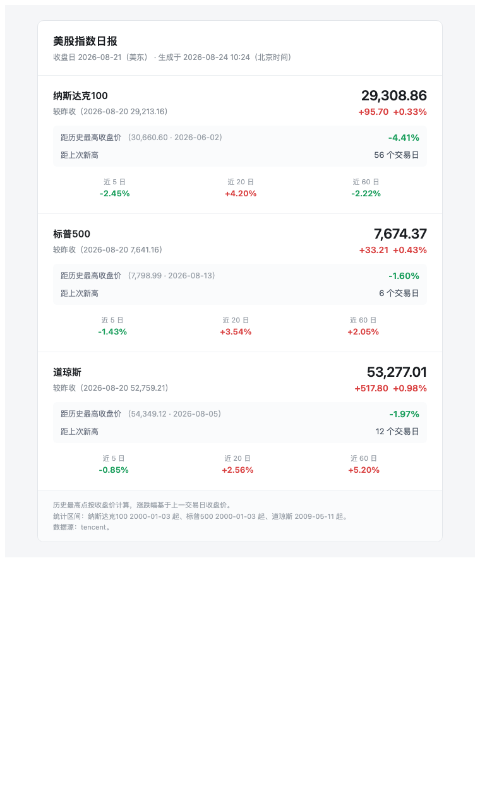

# 美股指数日报

每个美股交易日收盘后发一封邮件，汇报纳斯达克 100、标普 500、道琼斯的**较上一交易日涨跌幅**与**距历史最高收盘价的回撤**。



## 设计取舍

**无状态。** 每次运行重新拉取全量日线、当场算完、发信、退出。因为只出每日一封汇总，不需要数据库，也就没有去重、幂等、以及在 CI 里回写状态这一整类问题。

**不依赖交易日历。** 「上一交易日」直接取日线序列中的前一根，周末和美股假日天然被跳过。是否休市则用「最新日线日期 vs 美东当前日期」判断，不匹配就静默跳过，因此不需要维护假日表，夏令时切换也无需改动。

**历史最高点按收盘价计算**，不用盘中最高价，避免闪崩插针把回撤算大。

**数据源双通道。** 主源为腾讯行情（国内直连可用，日线上限 800 根，按日期向前翻页取全量）；失败时回落到 Yahoo Finance（GitHub Actions 的美国 runner 可用，国内直连通常 403）。

## 快速开始

```bash
python3 -m venv .venv && .venv/bin/pip install -r requirements.txt
cp .env.example .env      # 填写 SMTP 配置

.venv/bin/python -m ndxmon.main --dry-run --force --out out/preview.html
```

`--dry-run` 只打印不发信，`--force` 忽略「今天是否为交易日」的检查，`--out` 输出 HTML 供浏览器预览。确认无误后去掉 `--dry-run` 即会真实发送。

## 部署到 GitHub Actions

推送到 GitHub 后，在 **Settings → Secrets and variables → Actions** 添加：

| Secret | 说明 |
| --- | --- |
| `SMTP_HOST` | 如 `smtp.qq.com` |
| `SMTP_PORT` | `465`（SSL）或 `587`（STARTTLS） |
| `SMTP_USER` | 邮箱账号 |
| `SMTP_PASS` | **授权码**，不是登录密码 |
| `MAIL_FROM` | 通常与 `SMTP_USER` 相同 |
| `MAIL_TO` | 收件人，多个用逗号分隔 |

工作流定时在 `30 22 * * 1-5`（UTC），对应美东 17:30，夏令时和冬令时都在收盘之后。也可以在 Actions 页面手动触发。

QQ 邮箱的授权码在「设置 → 账号 → POP3/SMTP服务」中生成；`From` 必须与登录账号一致，否则会被退信。

## 运行失败怎么知道

数据源全部失败、数据校验不通过、SMTP 报错时进程都会以非零码退出，GitHub 会自动给仓库所有者发一封 workflow 失败通知邮件。渲染出的 HTML 会作为 artifact 保留 7 天便于排查。

需要注意「没收到邮件」有两种可能：美股休市（正常），或任务从未被触发。GitHub 对长期无提交的仓库会暂停 schedule，届时需要手动去 Actions 页面恢复。

## 修改监控标的

编辑 `config.yaml`，`code` 为腾讯行情代码，`yahoo` 为兜底源代码：

```yaml
indices:
  - name: 纳斯达克综合
    code: usIXIC
    yahoo: "^IXIC"
```

`history.start` 控制历史最高点的统计区间。腾讯源对纳指 100 和标普 500 可回溯至 2000-01-03（已覆盖 2000 年互联网泡沫顶），道琼斯仅到 2009-05-11——其 2007 年峰值远低于当前点位，不影响历史高点判定。邮件末尾会标注每个指数的实际统计区间。

## 项目结构

```
ndxmon/
  providers.py   数据源：腾讯分页拉取 + Yahoo 兜底
  metrics.py     指标计算与数据质量校验
  render.py      邮件主题 / HTML / 纯文本渲染
  mailer.py      SMTP 发送
  main.py        命令行入口与交易日判定
tests/           指标口径的单元测试
```

```bash
.venv/bin/python -m pytest tests -q
```
